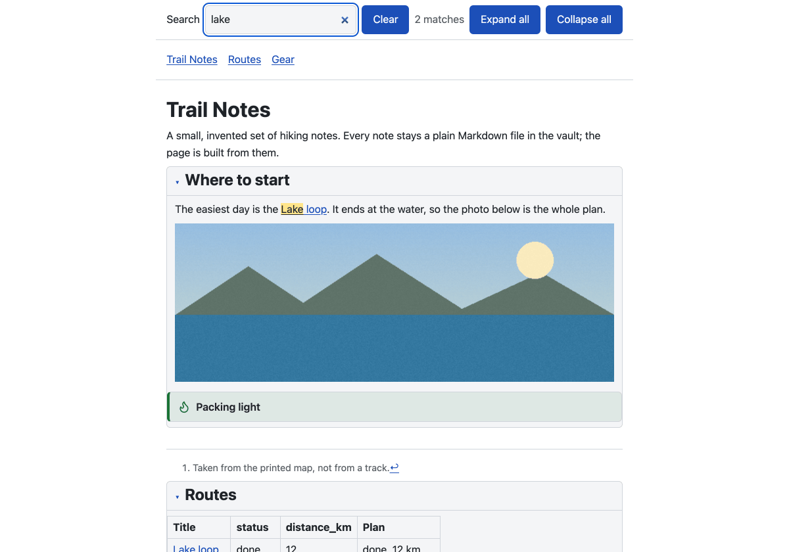
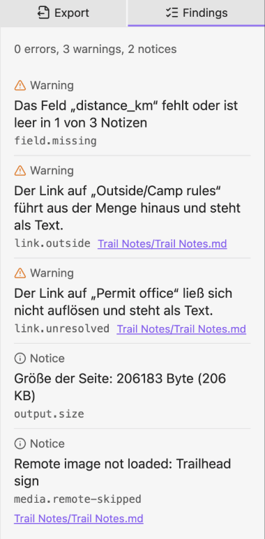
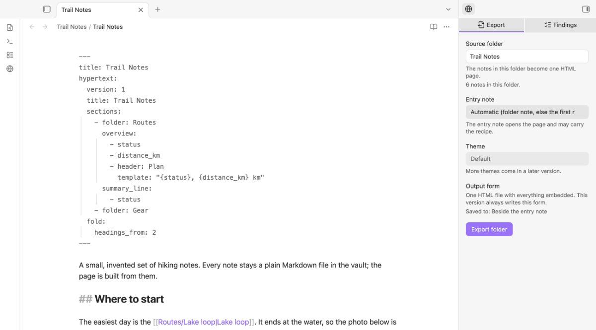
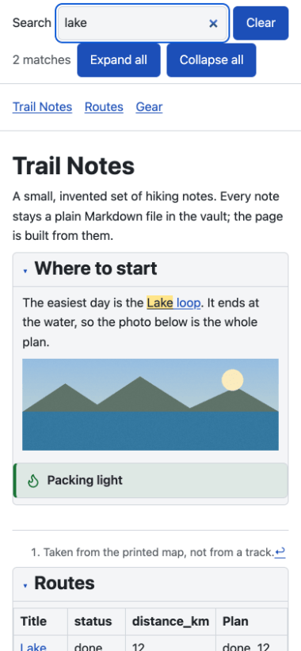

# Hypertext Exporter

Exportiert einen Ordner mit Markdown-Notizen als eine eigenständige HTML-Seite: aufklappbar, durchsuchbar, aus deinen Notizen gebaut und nie von einem Modell geschrieben.

[](https://github.com/johannes-kaindl/hypertext-exporter/blob/main/LICENSE)
[](https://github.com/johannes-kaindl/hypertext-exporter/blob/main/LICENSE-DOCS)
[](https://github.com/johannes-kaindl/hypertext-exporter/releases)
[](https://github.com/johannes-kaindl/hypertext-exporter/blob/main/manifest.json)

> [🇬🇧 English](https://github.com/johannes-kaindl/hypertext-exporter/blob/main/README.md) · 🇩🇪 Deutsch
>
> **Hinweis:** Diese Übersetzung folgt der englischen README. Bei Abweichungen gilt die englische Fassung.

<p align="center"></p>

## Features

- **Die Notizen bleiben die Quelle.** Die Seite ist ein Erzeugnis: dieselben Notizen in derselben Umgebung ergeben dieselbe Datei, Byte für Byte. Keine Uhrzeit, kein Zufallswert, kein Benutzerpfad darin.
- **Eine Datei, die für sich steht.** Stil, Bilder und das eine Skript sind eingebettet; beim Öffnen wird nichts aus dem Netz geladen.
- **Klappt auf wie deine Notizen.** Callouts mit `-` oder `+` falten wie geschrieben; jede Notiz ist ein Block, der sich per Klick öffnet; eine Bauanleitung kann auch die Abschnitte der Einstiegsnotiz falten.
- **Suche, die aufklappt, was sie findet.** Tippe ins Suchfeld: Blöcke ohne die Wörter verschwinden, Blöcke mit ihnen öffnen sich und die Wörter sind hervorgehoben. `Escape` stellt alles wieder her.
- **Übersichten aus dem Frontmatter.** Eine Tabelle mit einer Zeile je Notiz aus den Feldern, die du nennst; eine Zusatzzeile unter jedem Titel.
- **Reihenfolge und Gruppen bestimmst du.** Nach Name, nach Zahlenpräfix, nach erster Erwähnung in der Einstiegsnotiz, nach einem Feld oder gruppiert nach ein oder zwei Feldern.
- **Befunde statt Schweigen.** Jeder Link, der nicht bleiben konnte, jede Datei, die sich nicht einbetten ließ, und jeder Block, der leer blieb, steht in einer Liste, mit Code und einer Meldung in der Sprache der Oberfläche.
- **Prüfbefehl und Kommandozeile.** *Check HTML export* baut die Seite neu und vergleicht sie Byte für Byte; ein Skript kann einen Export starten und die Antwort lesen.
- **Sicher gebaut.** Text aus einer Notiz wird in der Seite nicht zu Programm; drei Schichten sagen warum (siehe [Funktionsweise](#funktionsweise)).

## Voraussetzungen

- **Obsidian 1.8.7** oder neuer.
- Desktop. Das Plugin ist nicht desktop-only und nutzt kein Node-Modul, es soll also auch am Handy laufen; das ist **vorgesehen und am Gerät noch nicht gemessen**.
- Ein Browser, um das Ergebnis zu öffnen. Die Seite lässt sich auch ohne ihr Skript lesen, die Suche braucht es.
- Das Obsidian-Fenster muss sichtbar bleiben, solange ein Export läuft (siehe [Bekannte Grenzen](#bekannte-grenzen)).

## Installation

**Community-Plugin-Liste (empfohlen, sobald veröffentlicht):** *Einstellungen* → *Community-Plugins* → *Durchsuchen* → nach **„Hypertext Exporter“** suchen → installieren und aktivieren. Das Plugin steht noch nicht in der Liste.

**Manuell:** `main.js`, `manifest.json` und `styles.css` aus einem [Release](https://github.com/johannes-kaindl/hypertext-exporter/releases) nach `<vault>/.obsidian/plugins/hypertext-exporter/` kopieren und unter *Community-Plugins* aktivieren.

**BRAT:** im Plugin BRAT *Add beta plugin* wählen und `johannes-kaindl/hypertext-exporter` eintragen.

**Aus dem Quelltext:** Repository klonen, `npm install && npm run build` ausführen und dieselben drei Dateien (`main.js`, `manifest.json`, `styles.css`) in denselben Ordner kopieren.

## Verwendung

### Eine erste Seite machen

1. Lege die Notizen eines Ordners zusammen; nenne die Einstiegsnotiz wie den Ordner (`Trail Notes/Trail Notes.md`) oder lass das Plugin die erste Notiz wählen.
2. Öffne die Einstiegsnotiz und führe **Insert export recipe** aus. Das fügt einen Block `hypertext:` ins Frontmatter ein.
3. Führe **Export current note as HTML page** aus. Eine Meldung nennt den Ort der Seite, und der Reiter **Findings** zeigt, was passiert ist.
4. Führe **Open HTML export** aus.

Die Schritt-für-Schritt-Fassung ist [Getting started](https://github.com/johannes-kaindl/hypertext-exporter/blob/main/docs/getting-started.md) (englisch).

### Wege in den Export

Die Befehle heißen in der Oberfläche englisch, wenn Obsidian englisch läuft, und deutsch bei deutscher Oberfläche: **Ordner als HTML-Seite exportieren…**, **Aktuelle Notiz als HTML-Seite exportieren**, **HTML-Export prüfen**, **HTML-Export öffnen**, **Export-Bauanleitung einfügen**. Hier stehen die englischen Namen.

| Wo | Was es tut |
|---|---|
| Befehl **Export folder as HTML page…** | Öffnet das Panel auf dem Ordner der aktiven Notiz; **Export folder** drücken. |
| Befehl **Export current note as HTML page** | Exportiert ohne Dialog. Eine Notiz mit Block `hypertext:` steht für ihren Ordner, eine ohne wird einzeln exportiert. |
| Dateimenü eines Ordners, **Export folder as HTML page…** | Öffnet das Panel auf diesem Ordner. |
| Dateimenü einer Notiz, **Export note as HTML page** | Wie der Befehl. |
| Befehl **Check HTML export** | Baut die Seite neu und vergleicht sie mit der am Ziel. |
| Befehl **Open HTML export** | Öffnet die Seite in der Standard-App (am Handy: das Teilen-Blatt). |
| Befehl **Insert export recipe** | Schreibt nach deiner Bestätigung eine Start-Bauanleitung ins Frontmatter der aktiven Notiz. Die einzige Stelle, an der das Plugin in eine Notiz schreibt. |
| `obsidian eval code="await app.plugins.plugins['hypertext-exporter'].api.exportAndWait('<pfad>')"` | Startet einen Export aus einem Skript und liefert die Ergebnisdatei. Siehe [Export from the command line](https://github.com/johannes-kaindl/hypertext-exporter/blob/main/docs/how-to/export-from-the-command-line.md) (englisch). Der Exit-Code ist immer 0; lies `ok` aus der Antwort. |

<a href="https://raw.githubusercontent.com/johannes-kaindl/hypertext-exporter/main/docs/images/findings.png"></a><br><sub>Der Reiter Findings nach einem Export — Klick auf die Vorschau für die volle Größe</sub>

### Die Bauanleitung

Die Bauanleitung ist der Block `hypertext:` im Frontmatter der Einstiegsnotiz. Sie nennt die Gruppen, die Reihenfolge, die Übersichten und was aufklappt. Ohne sie ergibt ein Ordner trotzdem eine gültige Seite: eine Gruppe je Unterordner, ein Block je loser Notiz, alles zu.

```yaml
hypertext:
  version: 1
  title: Trail Notes
  sections:
    - folder: Routes
      overview:
        - status
        - distance_km
        - header: Plan
          template: "{status}, {distance_km} km"
      summary_line:
        - status
    - folder: Gear
  fold:
    headings_from: 2
```



Jeder Schlüssel hat einen deutschen Alias (`sections` heißt auch `bereiche`). Ein falsch geschriebener Schlüssel ist eine Warnung, die ihn nennt; ein falscher Wert hält den Lauf an, bevor etwas geschrieben wird.

<a href="https://raw.githubusercontent.com/johannes-kaindl/hypertext-exporter/main/docs/images/page-mobile.png"></a><br><sub>Die Seite bei 390 Pixel Breite — Klick auf die Vorschau für die volle Größe</sub>

### Bekannte Grenzen

- **Das Teilen-Verzeichnis ist kein Ablageort.** Beim Ziel „Share sheet“ geht die Seite in einen versteckten Ordner im Vault, und der nächste Export löscht dort ältere Dateien gleicher Art ohne Rückfrage.
- **Der Exit-Code der Kommandozeile ist immer 0.** Lies `ok` in der Antwort.
- **Minimiere das Obsidian-Fenster nicht während eines Exports.** Obsidian drosselt ein verdecktes Fenster so stark, dass der Export nicht fertig würde; das Plugin hält dann mit `render.hidden-window` an.
- **Mathe-Schriften sind nicht eingebettet.** Formeln zeigen eine Ersatzschrift (`math.font-url`).
- **Ein roher Rahmen in einer Notiz wird durch Text ersetzt.** Ein `<iframe>`, `<object>`, `<embed>` oder `<webview>` im Notiztext wird vor dem Zeichnen zu `[iframe]` und so weiter (`prepare.frame-replaced`).
- **Ton, Film und andere Anhänge sind noch nicht eingebettet.** Die Seite zeigt den Dateinamen (`media.later`). Bilder, auch SVG, sind eingebettet.
- **Die Suche hebt höchstens 5000 Treffer hervor.** Ein Wort über zwei Textknoten wird gefunden, aber nicht hervorgehoben.
- **Noch nicht gebaut und nicht zugesagt:** andere Themen als das Standard-Thema, ein Paket aus Dateien statt einer Datei, Bilder aus dem Netz, ein Zustandsraster für Tabellen. Ihre Schlüssel werden gelesen und mit einer Warnung beantwortet (`recipe.not-yet`).
- **Am iPhone und iPad geht die Seite als Vorschau ohne ihr Skript auf.** Der Export selbst läuft dort (gemessen an einem iPhone mit iOS 26: unter zehn Sekunden, zweimal dieselben Bytes, dieselben Befunde wie am Mac). Die App Dateien zeigt die fertige Seite in einer Vorschau, die kein Skript ausführt: Der Text steht da, die Suchzeile und die Knöpfe *Alles aufklappen* und *Alles zuklappen* fehlen. Safari unter iOS öffnet keine lokale Datei, es bietet nur an, sie zu sichern. Von einer Webadresse geladen (eigene Website oder ein Webserver), führt Safari die Seite mit Suche aus (gemessen im iOS-26.5-Simulator). Am Computer öffnet jeder Browser die Datei direkt.
- **Wogegen die Seite nicht schützt:** Inhalt, der täuscht, ein Plugin, das beim Zeichnen einer Notiz etwas tut, und jemand, der die fertige Datei ändert. Siehe [Security and determinism](https://github.com/johannes-kaindl/hypertext-exporter/blob/main/docs/explanation/security-and-determinism.md) (englisch).

## Konfiguration

*Einstellungen* → *Community-Plugins* → **Hypertext Exporter**. Hier steht nur, was die Seite nicht ändert; alles, was sie ändert, steht in der Bauanleitung.

| Einstellung | Standard | Bedeutung |
|---|---|---|
| Save the page to (Seite speichern in) | Beside the entry note (neben der Einstiegsnotiz) | Oder: ein Ordner im Vault, oder das Teilen-Blatt (ein versteckter Ordner, dann das Teilen-Blatt oder die Standard-App). Der Ort ändert die Seite nicht. |
| Export folder (Export-Ordner) | `exports` | Gilt nur, wenn die Seite in einem Ordner im Vault gespeichert wird. |
| Themes folder (Themen-Ordner) | `hypertext-themes` | Vorgesehen für eigene Themen. Themen sind noch nicht gebaut, die Einstellung hat in dieser Version keine Wirkung. |

Die Seite heißt `<Notizname>.html`; daneben liegt `<Notizname>.export.json`, die Ergebnisdatei (nicht beim Teilen-Blatt).

Die Bauanleitung (`hypertext:` in der Einstiegsnotiz). Alle Schlüssel, Aliase und Wertregeln stehen in der [Recipe reference](https://github.com/johannes-kaindl/hypertext-exporter/blob/main/docs/reference/recipe.md) (englisch).

| Schlüssel | Werte | Standard | Bedeutung |
|---|---|---|---|
| `version` | `1` | `1` | Fassung des Formats der Bauanleitung. |
| `title` | Text | Titel der Einstiegsnotiz | Titel der Seite. |
| `lang` | `en`, `de` | `en` | Sprache der Texte, die die Seite selbst setzt (Suche, Sprunglink). |
| `sections` | Liste | eine Gruppe je Unterordner | Gruppen und lose Notizen: `folder`, `note`, `source` oder `sources` (eine Gruppe über mehrere Quellen), dazu `title`, `order`, `group_by`, `title_from`, `overview`, `summary_line` (Spalten mit `label`), `open`. |
| `sources` | Liste von Ordnern | keine | Ordner außerhalb des exportierten, die dazugehören, mit `key` und `title`. |
| `fields` | `title`, `order`, `exclude` | die festen Namen | Welches Feld deiner Notizen Titel, Reihenfolge und Ausschluss trägt. |
| `fold` | `headings_from`, `linked_summary` | keine Faltung | Ab welcher Überschriftsebene die Einstiegsnotiz faltet; ob ein Block die Zusatzzeile der Notiz zeigt, auf die er verlinkt. |
| `blocks` | `none`, `core`, `all` | `core` | Welche Codeblöcke gezeichnet werden dürfen: keine (Mermaid bleibt Quelltext), Mermaid und Mathe, oder die jedes Plugins. |
| `remote_images` | `skip` | `skip` | Bilder mit Adresse im Netz werden nicht geladen und zu einem Hinweis mit Link. (`embed` ist noch nicht gebaut.) |
| `stamp` | `minimal`, `full` | `minimal` | `full` listet im Kopf der Seite auch die aktiven Community-Plugins. |
| `output` / `output_limit_mb` | `auto`, `file` / Zahl | `auto` / `20` | Es entsteht immer eine HTML-Datei. Über der Grenze warnt der Lauf. (`package` ist noch nicht gebaut.) |
| `embeds` | `static` | `static` | Nichts wird aus dem Netz geladen. |
| `theme` | `default` | `default` | Es gibt nur das Standard-Thema. |

## Funktionsweise

Der Export ist eine feste Folge von Schritten. Die Notizen der Menge werden gesammelt und geordnet, die Bauanleitung wird gelesen und geprüft, und jede Notiz zeichnet Obsidians eigener Renderer in einem verborgenen Host in deinem Fenster, damit Callouts, Tabellen, Fußnoten, Mermaid und Mathe aussehen wie in Obsidian. Danach entfernt ein Schutzdurchgang aktive Inhalte, Marken und Links werden umgeschrieben (ein Link auf eine Notiz der Menge wird ein Sprung, jeder andere Text), Blöcke falten, Übersichten entstehen aus dem Frontmatter, Bilder werden als `data:`-Adressen eingebettet, und die Seite entsteht mit einem Stilblock, einem Skript und einer Content-Security-Policy, die deren Prüfsummen trägt. Zuletzt wird der fertige Text zurückgelesen und noch einmal geprüft.

Die Seite ist in drei Schichten geschützt: Obsidians Renderer lässt Skripte weg, das Plugin entfernt sie noch einmal (und Rahmen, Formulare und `<base>`) und prüft dann die fertige Seite ein zweites Mal, und die Policy `default-src 'none'` hindert alles, was durchgerutscht wäre, am Laden und Laufen. Ein Stempel im Kopf der Seite nennt Plugin-Version, Obsidian-Version und -Sprache, Thema und Schalter, ohne Datum, damit eine geänderte Umgebung als geänderte Datei sichtbar wird.

Die reinen Teile (Menge, Bauanleitung, Struktur, Seite, Prüfungen) kennen Obsidian nicht und sind ohne es getestet; nur Zeichnen und Schreiben sprechen mit Obsidian. Die lange Fassung ist [Security and determinism](https://github.com/johannes-kaindl/hypertext-exporter/blob/main/docs/explanation/security-and-determinism.md) (englisch).

## Dokumentation

- [Dokumentations-Index](https://github.com/johannes-kaindl/hypertext-exporter/blob/main/docs/README.md) (englisch)
- [Getting started](https://github.com/johannes-kaindl/hypertext-exporter/blob/main/docs/getting-started.md) — von der Installation zur ersten Seite
- [Troubleshooting](https://github.com/johannes-kaindl/hypertext-exporter/blob/main/docs/troubleshooting.md) — die Meldungen, die du sehen kannst, was sie bedeuten und was zu tun ist

## Lizenz

AGPL-3.0-or-later — siehe [LICENSE](https://github.com/johannes-kaindl/hypertext-exporter/blob/main/LICENSE). Die Dokumentation steht unter CC BY-SA 4.0, siehe [LICENSE-DOCS](https://github.com/johannes-kaindl/hypertext-exporter/blob/main/LICENSE-DOCS).
