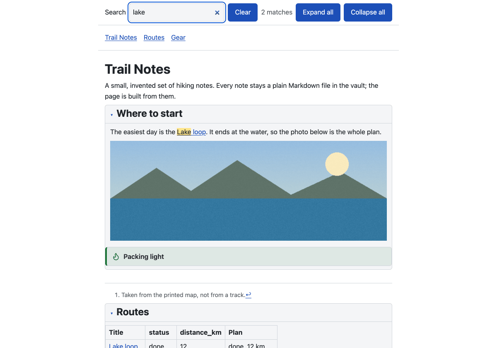
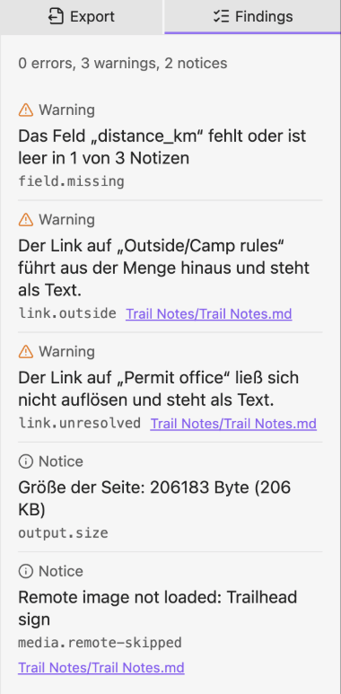
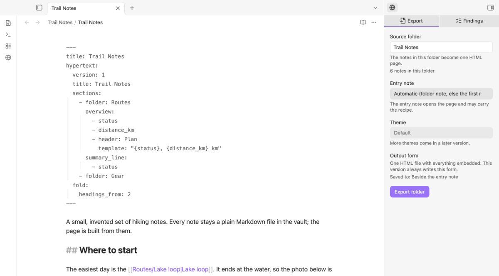
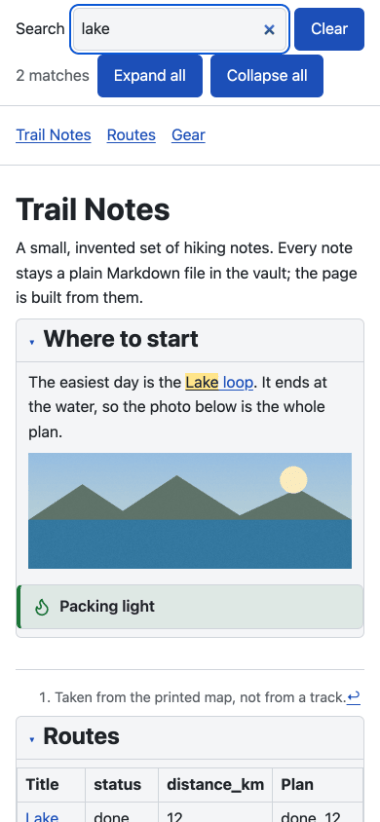

# Hypertext Exporter

Export a folder of Markdown notes as one self-contained HTML page: foldable, searchable, and made from your notes, never written by a model.

[](https://github.com/johannes-kaindl/hypertext-exporter/blob/main/LICENSE)
[](https://github.com/johannes-kaindl/hypertext-exporter/blob/main/LICENSE-DOCS)
[](https://github.com/johannes-kaindl/hypertext-exporter/releases)
[](https://github.com/johannes-kaindl/hypertext-exporter/blob/main/manifest.json)

> 🇬🇧 English · [🇩🇪 Deutsch](https://github.com/johannes-kaindl/hypertext-exporter/blob/main/README.de.md)

<p align="center"></p>

## Features

- **The notes stay the source.** The page is a product: the same notes in the same environment give the same file, byte for byte. No time, no random value, no user path in it.
- **One file that stands alone.** Styles, images and the one script are inside; opening it loads nothing from the web.
- **Folds like your notes.** Callouts with `-` or `+` fold as written; each note is a block that opens on click; a recipe can fold the sections of the entry note too.
- **Search that opens what it finds.** Type into the search field: blocks without the words disappear, blocks with them open and the words are highlighted. `Escape` puts everything back.
- **Overviews from front matter.** A table with one row per note, built from the fields you name; a summary line under each title.
- **Order and groups you decide.** By name, by number prefix, by first mention in the entry note, by a field, or grouped by one or two fields.
- **Findings, not silence.** Every link that could not be kept, every file that could not be embedded and every block that stayed empty is listed, with a code and a message in the language of the interface.
- **Check and command line.** *Check HTML export* rebuilds the page and compares it byte for byte; a script can start an export and read the answer.
- **Safe by construction.** Text from a note does not become a program in the page; three layers say why (see [How it works](#how-it-works)).

## Requirements

- **Obsidian 1.8.7** or newer.
- Desktop. The plugin is not desktop-only and uses no Node module, so it is meant to run on a phone as well; that is **intended and not yet measured on a device**.
- A browser to open the result. The page reads without its script, but the search needs it.
- The Obsidian window must stay visible while an export runs (see [Known limits](#known-limits)).

## Install

**Community plugin list (recommended, once published):** *Settings* → *Community plugins* → *Browse* → search for **"Hypertext Exporter"** → install and enable. The plugin is not in the list yet.

**Manual install:** copy `main.js`, `manifest.json` and `styles.css` from a [release](https://github.com/johannes-kaindl/hypertext-exporter/releases) into `<vault>/.obsidian/plugins/hypertext-exporter/`, then enable it under *Community plugins*.

**BRAT:** in the BRAT plugin choose *Add beta plugin* and enter `johannes-kaindl/hypertext-exporter`.

**From source:** clone the repository, run `npm install && npm run build`, then copy the same three files (`main.js`, `manifest.json`, `styles.css`) into the same folder.

## Usage

### Make a first page

1. Put the notes of a folder together; name the entry note like the folder (`Trail Notes/Trail Notes.md`) or let the plugin pick the first note.
2. Open the entry note and run **Insert export recipe**. It adds a `hypertext:` block to the front matter.
3. Run **Export current note as HTML page**. A notice says where the page was saved, and the **Findings** tab shows what happened.
4. Run **Open HTML export**.

The step-by-step version is [Getting started](https://github.com/johannes-kaindl/hypertext-exporter/blob/main/docs/getting-started.md).

### Ways into an export

| Where | What it does |
|---|---|
| Command **Export folder as HTML page…** | Opens the panel on the folder of the active note; press **Export folder**. |
| Command **Export current note as HTML page** | Exports without a dialog. A note with a `hypertext:` block stands for its folder; a note without one is exported alone. |
| File menu of a folder, **Export folder as HTML page…** | Opens the panel on that folder. |
| File menu of a note, **Export note as HTML page** | Same as the command. |
| Command **Check HTML export** | Rebuilds the page and compares it with the one at the destination. |
| Command **Open HTML export** | Opens the page in your default app (on a phone: the share sheet). |
| Command **Insert export recipe** | Writes a starting recipe into the front matter of the active note, after you confirm. The only place where the plugin writes into a note. |
| `obsidian eval code="await app.plugins.plugins['hypertext-exporter'].api.exportAndWait('<path>')"` | Starts an export from a script and returns the result file. See [Export from the command line](https://github.com/johannes-kaindl/hypertext-exporter/blob/main/docs/how-to/export-from-the-command-line.md). The exit code is always 0; read `ok` from the answer. |

<a href="https://raw.githubusercontent.com/johannes-kaindl/hypertext-exporter/main/docs/images/findings.png"></a><br><sub>The Findings tab after an export — click the preview for full size</sub>

### The recipe

The recipe is the `hypertext:` block in the front matter of the entry note. It names the groups, the order, the overview tables and what folds. Without it, a folder still gives a valid page: one group per subfolder, one block per loose note, everything closed.

```yaml
hypertext:
  version: 1
  title: Trail Notes
  sections:
    - folder: Routes
      overview:
        - status
        - distance_km
        - header: Plan
          template: "{status}, {distance_km} km"
      summary_line:
        - status
    - folder: Gear
  fold:
    headings_from: 2
```



Every key has a German alias (`sections` is also `bereiche`). A misspelled key is a warning that names it; a wrong value stops the run before anything is written.

<a href="https://raw.githubusercontent.com/johannes-kaindl/hypertext-exporter/main/docs/images/page-mobile.png"></a><br><sub>The page at 390 pixels wide — click the preview for full size</sub>

### Known limits

- **The share folder is not a place to keep files.** With the destination "Share sheet", the page goes to a hidden folder in the vault, and the next export deletes older files of the same kind there without asking.
- **The exit code of the command line is always 0.** Read `ok` in the answer.
- **Do not minimise the Obsidian window during an export.** Obsidian slows a hidden window down so much that the export would not finish; the plugin stops with `render.hidden-window` instead.
- **Maths fonts are not embedded.** Formulas show a fallback font (`math.font-url`).
- **A raw frame in a note is replaced by text.** An `<iframe>`, `<object>`, `<embed>` or `<webview>` in the note text becomes `[iframe]` and so on before drawing (`prepare.frame-replaced`).
- **Audio, video and other attachments are not embedded yet.** The page shows the file name (`media.later`). Images, including SVG, are embedded.
- **Search highlights at most 5000 matches.** A word that straddles two text nodes is found but not highlighted.
- **Not built yet, and not promised:** themes other than the default, a package of files instead of one file, remote images, a state grid for tables. Their recipe keys are read and answered with a warning (`recipe.not-yet`).
- **Mermaid diagrams need a recent Obsidian.** Obsidian 1.15.1 draws them so that they are embedded. Obsidian 1.12.4 draws them in a form the page's checker rejects: the diagram is left out of the page, and the result file says so (`guard.removed`). Versions in between are not measured.
- **On iPhone and iPad the page opens as a preview without its script.** The export itself runs there (measured on an iPhone with iOS 26: under ten seconds, the same bytes twice, the same findings as on a Mac). The Files app shows the finished page in a preview that runs no script: the text is there, the search row and the buttons *Expand all* and *Collapse all* are not. Safari on iOS does not open a local file; it only offers to save it. Served from a web address (your own website or a web server), Safari runs the page with search (measured in the iOS 26.5 Simulator). On a computer, every browser opens the file directly.
- **What the page does not protect against:** content that deceives, a plugin that acts while a note is drawn, and anyone who edits the finished file. See [Security and determinism](https://github.com/johannes-kaindl/hypertext-exporter/blob/main/docs/explanation/security-and-determinism.md).

## Configuration

*Settings* → *Community plugins* → **Hypertext Exporter**. Only what does not change the page lives here; everything that does goes into the recipe.

| Setting | Default | Meaning |
|---|---|---|
| Save the page to | Beside the entry note | Or: a folder in the vault, or the share sheet (a hidden folder, then the share sheet or the default app). The place does not change the page. |
| Export folder | `exports` | Used only when the page is saved to a folder in the vault. |
| Themes folder | `hypertext-themes` | Reserved for your own themes. Themes are not built yet, so the setting has no effect in this version. |

The page is written as `<note name>.html`; next to it lies `<note name>.export.json`, the result file (not with the share sheet).

The recipe (`hypertext:` in the entry note). All keys, aliases and the rules of the values are in the [recipe reference](https://github.com/johannes-kaindl/hypertext-exporter/blob/main/docs/reference/recipe.md).

| Key | Values | Default | Meaning |
|---|---|---|---|
| `version` | `1` | `1` | Version of the recipe format. |
| `title` | text | title of the entry note | Title of the page. |
| `lang` | `en`, `de` | `en` | Language of the texts the page itself writes (search, skip link). |
| `sections` | list | one group per subfolder | Groups and loose notes: `folder`, `note`, `source`, or `sources` (one group over several sources), with `title`, `order`, `group_by`, `title_from`, `overview`, `summary_line` (columns may carry a `label`), `open`. |
| `sources` | list of folders | none | Folders outside the exported one that belong to it, with `key` and `title`. |
| `fields` | `title`, `order`, `exclude` | the fixed names | Which field of your notes holds the title, the order and the exclusion. |
| `fold` | `headings_from`, `linked_summary` | no folding | From which heading level on the entry note folds; whether a block shows the summary line of the note it links to. |
| `blocks` | `none`, `core`, `all` | `core` | Which code blocks may be drawn: none (Mermaid stays source), Mermaid and maths, or every plugin's. |
| `remote_images` | `skip` | `skip` | Images with a web address are not loaded and become a note with the link. (`embed` is not built yet.) |
| `stamp` | `minimal`, `full` | `minimal` | `full` also lists the enabled community plugins in the head of the page. |
| `output` / `output_limit_mb` | `auto`, `file` / number | `auto` / `20` | One HTML file is always written. Above the limit a warning says so. (`package` is not built yet.) |
| `embeds` | `static` | `static` | Nothing is loaded from the web. |
| `theme` | `default` | `default` | Only the default theme exists. |

## How it works

The export is a fixed series of steps. The notes of the set are collected and put in order, the recipe is read and checked, and every note is drawn by Obsidian's own renderer in a hidden host in your window, so callouts, tables, footnotes, Mermaid and maths look as they do in Obsidian. A protection pass then removes active content, anchors and links are rewritten (a link to a note in the set becomes a jump, any other becomes text), blocks fold, overviews are built from the front matter, images are embedded as `data:` addresses, and the page is assembled with one style block, one script and a content security policy that carries their checksums. Last, the finished text is read back and checked again.

The page is protected in three layers: Obsidian's renderer drops scripts, the plugin removes them again (and frames, forms and `<base>`) and then checks the finished page a second time, and the policy `default-src 'none'` stops anything that slipped through from loading or running. A stamp in the head of the page names the plugin version, the Obsidian version and language, the theme and the switches, without a date, so that a changed environment shows up as a changed file.

The pure parts (set, recipe, structure, page, checks) know nothing about Obsidian and are tested without it; only drawing and writing talk to Obsidian. The long version is [Security and determinism](https://github.com/johannes-kaindl/hypertext-exporter/blob/main/docs/explanation/security-and-determinism.md).

## Documentation

- [Documentation index](https://github.com/johannes-kaindl/hypertext-exporter/blob/main/docs/README.md)
- [Getting started](https://github.com/johannes-kaindl/hypertext-exporter/blob/main/docs/getting-started.md) — from the install to your first page
- [Troubleshooting](https://github.com/johannes-kaindl/hypertext-exporter/blob/main/docs/troubleshooting.md) — the messages you may see, what they mean and what to do

## License

AGPL-3.0-or-later — see [LICENSE](https://github.com/johannes-kaindl/hypertext-exporter/blob/main/LICENSE). The documentation is licensed CC BY-SA 4.0, see [LICENSE-DOCS](https://github.com/johannes-kaindl/hypertext-exporter/blob/main/LICENSE-DOCS).
