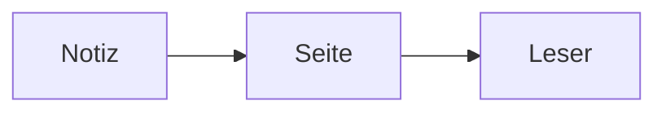

Diese Notiz sammelt Blöcke und Links, die der Export eigens behandeln muss.

## Diagramm



## Mathematik

Inline: $E = mc^2$.

$$
\int_0^1 x^2 \, dx = \frac{1}{3}
$$

## Code

```ts
export function verdopple(zahl: number): number {
  return zahl * 2;
}
```

## Abfrage

```dataview
LIST
FROM "kapitel"
```

## Hinweise

> [!note]- Zugeklappter Hinweis
> Dieser Hinweis ist zu, bis jemand ihn öffnet.

> [!tip]+ Offener Hinweis
> Dieser Hinweis ist offen und lässt sich zuklappen.

> [!info]
> Dieser Hinweis ist ein fester Kasten.

## Aufgaben

- [x] Bauanleitung schreiben
- [ ] Seite prüfen
- [ ] Seite weitergeben

## Tabelle

| Fall | Erwartung |
|---|---|
| Link nach außen | bleibt ein Link |
| Link in den Vault | wird ein Sprung |
| Link ohne Ziel | wird Text |

Ein ==markierter== Satz.

## Links

Ein Link nach außen: [Beispielseite](https://example.org/).
Ein Link auf eine Datei außerhalb der Menge: [[ausserhalb/notiz|Notiz außerhalb]].
Derselbe Link als Markdown-Link: [Notiz außerhalb, relativ](../../ausserhalb/notiz.md).
Ein Link ohne Ziel: [[Gibt es nicht]].
Ein Link auf eine Überschrift: [[kapitel/01 Grundlagen#Abschnitt]].
Ein Link auf einen Absatz: [[kapitel/01 Grundlagen#^absatz]].
Ein Link in dieselbe Notiz: [[#Diagramm]].

## Rohes HTML

<iframe src="app://x"></iframe>

<details><summary>Rohes Aufklappfeld</summary>Dieses Feld bleibt, wie es ist.</details>
